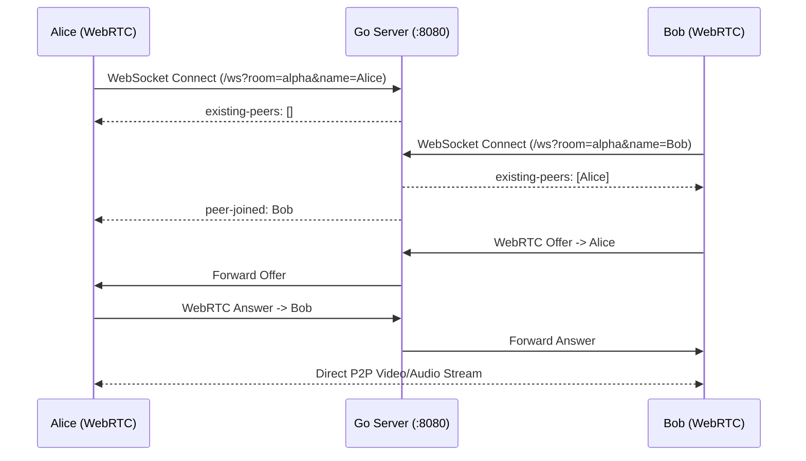

# MeetStream - Go + HTMX + WebRTC Video Meeting Platform

A lightweight, self-contained multi-user video calling platform built with **Go**, **HTMX**, and native **WebRTC**.

## Architecture & Features

- **Backend**: Go standard library `net/http` + Gorilla WebSocket for real-time signaling.
- **Frontend**: HTMX for dynamic interactions without heavy SPA frameworks.
- **WebRTC Mesh**: P2P multi-participant video and audio mesh network with Google STUN failover.
- **In-Room Chat**: Real-time broadcast text chat with timestamps and unread notification badges.
- **Media Controls**:
  - Audio mute/unmute toggle.
  - Camera video on/off toggle (displays avatar initials when camera is off).
  - Screen sharing via `navigator.mediaDevices.getDisplayMedia` with automatic track replacement.
  - Meeting link copy with toast notification.
  - Live participant roster and counter.
- **Self-hosted assets**: HTMX 2.0.4 is vendored locally in `static/js/htmx.min.js`. NAT traversal uses Google's public STUN servers; set `TURN_URL` to add a TURN relay for peers behind symmetric NAT.
- **Robust signaling**:
  - Offer/answer follows the WebRTC "perfect negotiation" pattern, so simultaneous offers resolve cleanly and ICE restarts on failure.
  - The client auto-reconnects with exponential backoff.
  - Screen sharing works even when you joined without a camera.
- **Server limits & safety**:
  - At most 8 participants per room and 1000 open rooms.
  - Each connection is limited to 20 messages/second (burst 200); a flooding client is disconnected.
  - Room and client IDs must match `[a-z0-9_-]{1,64}`; display names are capped at 40 characters and chat messages at 2000.
  - A duplicate client ID in a room is rejected, so a connection cannot hijack another peer.
  - WebSocket upgrades require a same-origin `Origin` header.
  - A client whose send buffer fills is disconnected rather than silently losing signaling messages.



## Quick Start

### 1. Run the Server

```bash
go run main.go
```

By default, the server runs on port `8080`. To customize the port:
```bash
PORT=3000 go run main.go
```

Browsers only allow camera and mic on `localhost` or HTTPS. To join from other devices on your LAN, serve over TLS:
```bash
TLS_CERT_FILE=cert.pem TLS_KEY_FILE=key.pem go run main.go
```

Optional TURN relay (credentials are sent to every room visitor, so use a dedicated low-privilege account):
```bash
TURN_URL=turn:turn.example.com:3478 TURN_USERNAME=user TURN_CREDENTIAL=pass go run main.go
```

### 2. Join a Room

1. Open `http://localhost:8080` in your browser.
2. Enter your display name.
3. Enter a room name or click **Generate** to create a random room slug.
4. Click **Join Meeting**.
5. Open another browser tab or an incognito window, navigate to the same room URL, and start communicating!

## Running Tests

Run all unit and integration tests:

```bash
go test -v ./...
```
